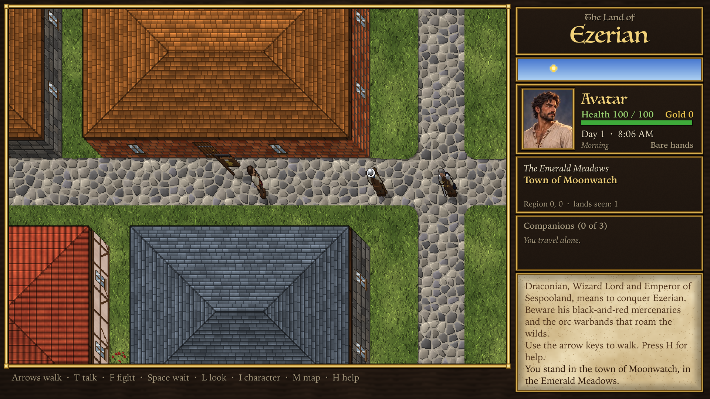
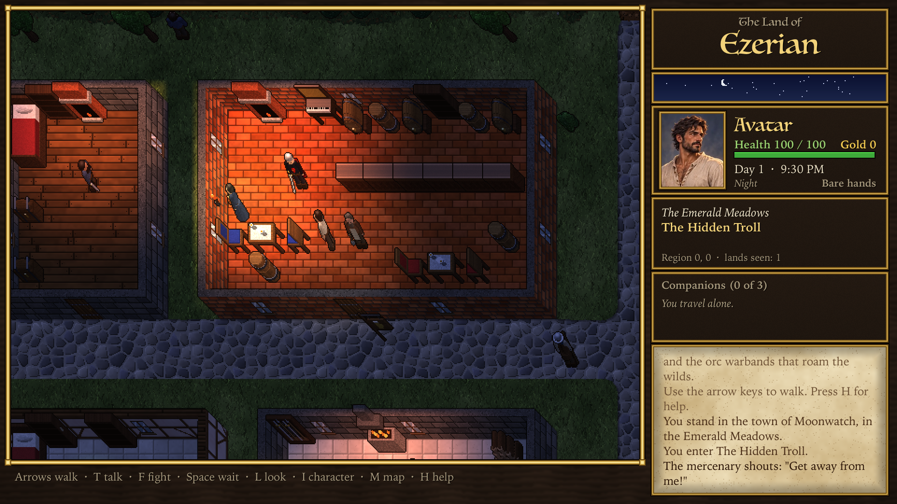
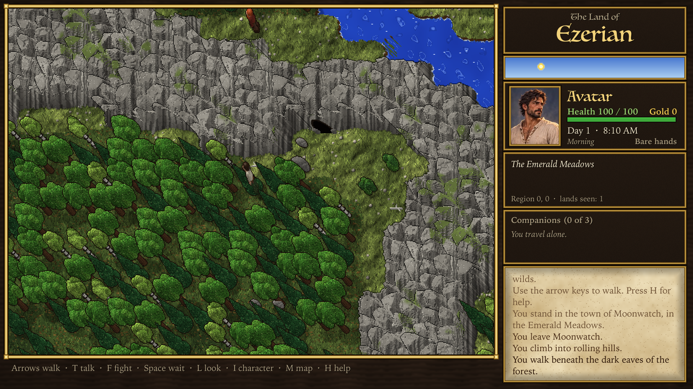
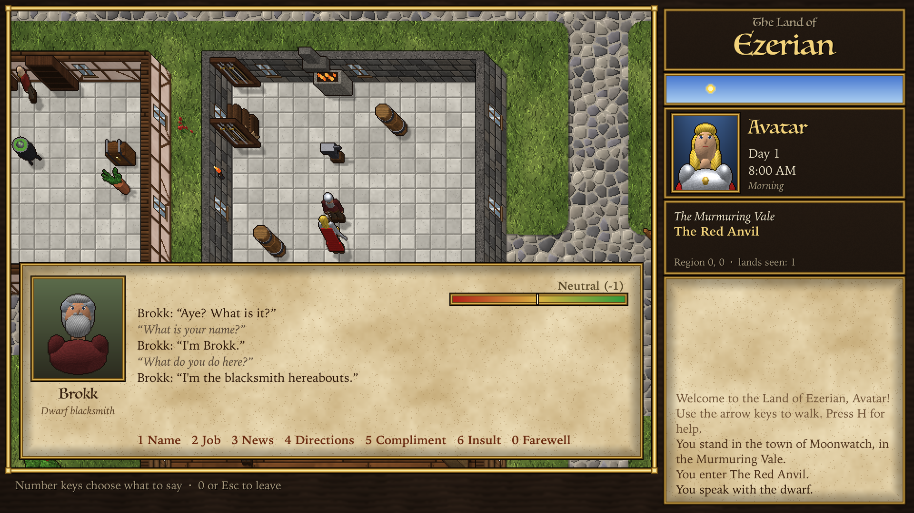

# The Land of Ezerian 2

The Land of Ezerian, made again with richer graphics. It is still a Mac-native,
single-player, turn-based RPG in the spirit of **Ultima VI** in which, for now, you
explore: walk an endless, randomly generated land of meadows, forests, rivers,
mountains, towns, taverns and caves, talk to the people you meet, gather companions,
and fight. There are no weapons or items yet.

The look follows the high-resolution Ultima VI remake in the reference screenshots
(kept in `screens/`, which git ignores): 32-pixel tiles with painterly textures, thick
walls seen in Ultima's leaning overhead view, hip roofs that lift away when you step
indoors, ink-outlined objects, and torchlit nights.









## Build and run

Requires macOS 13 or later and Swift 5.9+ (Xcode or the Command Line Tools).

```bash
./build_app.sh
```

```bash
open "build/Land of Ezerian 2.app"
```

During development you can also run it straight from SwiftPM:

```bash
swift run -c release Ezerian
```

## Controls

| Key | Action |
| --- | --- |
| Arrow keys / WASD | Walk (hold two arrows to walk diagonally) |
| Q E Z C, numpad | Walk diagonally |
| Click / hold on the map | Walk toward the pointer |
| Right-click | Look at whatever (or whoever) is under the pointer |
| T, or walk into someone | Talk to them |
| Type, then Return | In a conversation: say anything; Esc to leave |
| F, then a direction | Attack whoever is there |
| Space | Wait a turn (in a fight: let your turn pass) |
| L | Look at the tile ahead |
| M | Map of the lands you have explored (+/- or scroll to zoom) |
| G | Show region borders on the map view |
| H or ? | Help |
| ⌘N | Begin a new world |
| ⌘S | Save (the game also saves automatically) |

A new game (first launch or ⌘N) begins by asking your character's name, then whether
you are a man or a woman (M or W, or the arrows and Return), with both shown as they
would look. The name appears in the side panel beside the Avatar's portrait, and both
are kept in the save file; NPCs voiced by Claude are told which you are. The Avatar sets
out with no armour and no weapon: just a laced linen shirt, slacks, a belt and a sash.

The Avatar's portraits are paintings (`Resources/Portraits`, copied into the app by
`build_app.sh`), drawn at the display's full resolution over the pixel art. There are
six for each of the man and the woman, from plain clothes through leather, mail, a
breastplate and plate to gilded plate (`Portraits.Outfit`); only the plain clothes are
used so far.

Walk into a door to go inside, into a sign to read it, and into a cave mouth to go
underground. A ladder brings you back up. The Avatar glides from tile to tile, but the
game is still turn-based: every step is a turn of two minutes.

## People

Ezerian is home to four races: **humans**, **elves**, **dwarves** and **orcs**. Every
NPC has a friendliness score from -100 (extremely hostile) to 100 (adoring), drawn from
a bell curve around their race's average: humans 25, elves 0, dwarves -25, orcs -50.
The score falls into five moods — hostile, unfriendly, neutral, friendly, adoring —
which decide how they answer you.

* **Where they live:** keepers in every shop, tavern, inn, smithy, temple and home
  (dwarves favour the forge), patrons in the taverns, townsfolk in the streets, elves
  in the woods, dwarf prospectors in the hills, orc bands at campfires and in caves,
  and travellers on the roads.
* **Each turn** they go about their business: most wander a little, hostile ones close
  in on you and growl, adoring ones come over to wave.
* **Talking:** walk into someone or press T. The conversation window shows their
  portrait, race, trade, mood and score, and a line where you type whatever you want
  to say. An NPC who loathes you (-85 or below) won't talk at all.
* **Claude voices the NPCs.** Each line you type goes to the Claude API
  (`claude-haiku-5-5`, Anthropic's fast, inexpensive model, at low effort with
  thinking off) with a character sheet: race and manner of speech, trade, friendliness
  score and mood, what they know of nearby inns, towns and landmarks, and what you
  have said to each other before. Claude answers in character, its tone set by the
  friendliness, and judges your words, returning structured JSON: the reply, the
  intent (greeting, friendly, compliment, question, small talk, rude, insult, threat,
  farewell or nonsense), the change in friendliness (-25 to 25), whether the NPC walks
  off, and whether they gave their name. The game applies the change at once, so
  kindness and rudeness carry over to later meetings, and each NPC remembers the last
  few exchanges.
* **Setting it up:** choose **Game ▸ Claude API Key…** and paste a key from
  console.anthropic.com (it is kept in your login keychain), or launch with
  `ANTHROPIC_API_KEY` set. **Game ▸ Voice Conversations with Claude** turns it off.
* **Companions:** up to three NPCs can travel in your party. Ask someone to join in
  your own words ("Will you travel with me?"), or a friendly NPC may ask you during a
  conversation (press Y or N). The chance either way is 0 at friendliness 0 or below
  and rises with friendliness — (friendliness ÷ 100)², so 25% at 50 and certain at 100.
  Companions walk behind you in single file, step aside (swap places) when you walk
  into them, follow you underground, and are listed in the side panel. You can still
  talk to them (press T beside them); if a conversation makes a companion like you
  less, they may leave, and you can tell one to leave ("it's time we parted ways").
  Someone who refused to join, or left, won't join until their friendliness is at
  least 35 points above what it was then. The party is kept in the save file.
* **Without Claude** (no key, offline, or an API error) the game falls back to scripted
  replies: your words are matched to a topic — name, job, news, directions,
  compliment, insult or farewell — and answered by mood, and the window says the
  reply was scripted.
* Each race speaks its own way, from courtly elves ("thou", "mortal") and gruff dwarves
  ("aye", "surface-dweller") to blunt orcs ("pinkskin").
* People, where they stand and how they feel about you are kept in the save file.

## The town watch

Every town keeps a watch of human guards: two or three in a small town, four in a big
one, led there by a captain. There are five ranks, each with a painted portrait (in
`Resources/Portraits`) shown when you talk to them, and a matching figure on the map:

| Rank | Wears | Carries | Health |
|---|---|---|---|
| Watchman / watchwoman | leather jerkin, quilted sleeves, kettle hat | spear | 40–69 |
| Serjeant of the watch | mail and the red tabard, kettle hat | spear | 70–99 |
| Man-at-arms / woman-at-arms | half plate and the blue tabard, sallet | halberd | 100–129 |
| Captain of the watch | studded brigandine and a dark cloak | sword | 130–159 |
| Knight of the watch | gilded plate and the blue tabard | halberd | 160–200 |

Health is drawn evenly within the rank's band, so a higher rank is always tougher.

The tabards bear the town's tower. Until they tell you their name, guards go by their
rank ("the serjeant of the watch"), and so does every human by their trade: "The
mercenary hits you…", "You speak with the bard." Townsmen, townswomen and beggars walk the
streets, peasants work the land round farmhouses and travel the roads, and the rest
keep shops, inns and homes. The other races go by their race ("the dwarf"). Claude knows them as members of the watch who
loathe Lord Draconian's mercenaries. Guards in towns explored before the watch existed
keep their old clothes and pixel portraits.

## Bards

Bards (humans, elves and dwarves in the town streets) each look like one of nine
painted bards of their race and sex, shown when you talk to them, and on the map
wear that painting's colours and play its instrument: a human lute player in a
feathered hat, a grey-haired flautist, an elf with a lyre and a dwarf with a drum;
and among the women, a lute player, a harpist and a grey-haired flautist, a dwarf
with a tambourine and an elf with a hurdy-gurdy. (The sheet's horned fiddler belongs
to no race of Ezerian and is not used.) Bards in towns explored before this keep
their old clothes and pixel portraits.

## Peasants

Peasants (always human) each look like one of ten painted peasants of their sex,
shown when you talk to them, and on the map wear that painting's colours and hat and
carry what they carry in it. The men are a farmer in a straw hat with a hoe, a miller
in a cap and apron with a sack of flour, a red-bearded woodcutter with his axe on his
shoulder, an old shepherd in a hood with a crook, and a fisherman in an apron with
his net. The women, in headscarves, carry a basket of vegetables, a loaf of bread,
a drop spindle and wool, a bucket, or a bunch of herbs. Peasants met before this keep
their old clothes and pixel portraits.

## Lord Draconian

The Wizard Lord Draconian, Emperor of Sespooland, means to conquer Ezerian, and his
people are already abroad. They wear his livery — a black tabard with his red sigil,
a red cloak and a steel helm — and the conversation window marks them "Serves Lord
Draconian".

* **Mercenaries:** humans, dwarves and elves in his pay, met loitering in town streets
  and taverns and in small groups on the roads and in the countryside. Their
  friendliness is drawn around -50 and always lies between -100 and 0.
* **His orcs:** half of all orcs serve him. They average -75, half again as
  unfriendly as other orcs (-50), and also stay between -100 and 0.
* **Roving warbands:** some of his orcs range the wilderness in bands of three to five
  led by a captain, roaming together across their whole region and hunting you down
  when you come within ten paces. Because the warbands are all his, orcs elsewhere
  serve him with a 35% chance, which keeps the total at half.
* **Never friends:** nothing you say raises his people above 0, so they never join your
  party. They close in on you when you're near, are likely to attack (see Combat), and
  in every fight with them, whoever strikes first, they cry "Thou shalt bow down
  before Lord Draconian, mighty emperor of Sespooland and Ezerian." Then
  when one of them fights, his fellow servants close by join in. Claude voices them as
  loyal to Draconian: they may boast of his coming conquest or let slip his plans,
  and ordinary folk speak of him as a rumour and a threat.

## Combat

* **Health:** the Avatar starts with 100 health points. Each NPC has 1–200, drawn as
  200·u^(5/3) for a uniform random u, so most are frail and a few are very tough; the
  average is 75 (the median about 63). Health shows in the side panel, for companions
  in the Companions box, and over everyone's head during a fight.
* **How fights start:**
  * You attack: press **F** and a direction. Your victim's friendliness drops by 60.
  * An unfriendly NPC standing beside you may attack on any turn, with chance
    (friendliness ÷ 100)², so -30 is 9% a turn, -60 is 36%, and -100 always attacks.
  * A conversation that leaves someone below 0, lower than before, may come to blows,
    with chance -friendliness ÷ 100.
* **Turns:** everyone takes a turn in a fixed round robin: you, then each companion,
  then the enemy (or the enemy first, if they started it). Everyone fights equally well:
  half of all blows land, for 1–10 damage plus the weapon's bonus. On your turn,
  walk into a foe to strike them (or press F and a direction), step elsewhere, or press
  Space to wait. Companions join the fight on your side; fighters strike the weakest
  foe in reach, or close in on the nearest. A pursuing foe falls behind one turn in
  four, so you can retreat: get more than 8 tiles away and you escape.
* **Weapons:** a staff adds 2 damage to every blow, a dagger 4, a mace 6, a short sword
  8 and a long sword 10. You start with none. The watch are armed by rank (watchmen
  staves, serjeants daggers, men-at-arms maces, captains short swords, knights long
  swords). Other people may carry one: the tougher they are, the likelier they're armed
  (about a third of the frail, three quarters of the toughest) and the better the
  weapon; Lord Draconian's people nearly always are, and children never. Kill someone
  yourself and you take their weapon; you always fight with the best one you have,
  shown under your health. Foes your companions kill keep theirs. Every blow names the
  weapon: "The orc hits you with his short sword.", "You miss the elf with your bare
  hands." Looking at someone tells you what they carry, and on the map everyone,
  you included, holds the weapon they really have (drawn as its own sprite in the
  figure's hand, so outfits no longer come with a weapon of their own). In 2,000 simulated duels
  against random people, a bare-handed Avatar now wins about 53%, against 67% before
  anyone was armed.
* **Choosing your fights:** between two bare-handed fighters, the fight goes to whoever has more
  health. Against a foe with 50 health you win 98% of the time, at 75 about 82%, at
  100 a coin toss, and at 125 one in five. Look at someone first (L or right-click):
  you'll see whether they're slight and frail, of ordinary build, sturdy, powerfully
  built or huge and formidable, and whether they're wounded.
* **Hit scores:** by default the scroll says only who hit whom ("You hit the orc.").
  Turn on **Options ▸ Show Hit Scores** to see the damage and the health left after
  every blow ("You hit the orc for 7: 31 of 60 left."). The setting is remembered
  between launches.
* **Healing:** out of a fight, you, your companions and the people around you recover
  1 health every 2 turns (30 an hour of game time).
* **Gold:** you start with no gold. Everyone else carries a purse of random size
  averaging one coin for every 10 points of their starting health (a Poisson draw, so
  a 75-health foe has 7 or 8 on average, sometimes none, sometimes a dozen or more).
  When a foe is killed in a fight, their gold passes to you; your total shows beside
  your health. Gold is kept in the save file.
* **Death:** anyone at 0 health dies. A companion who dies is gone from your party.
  If the Avatar dies the game is over, and Return begins a new adventure in a new world.

## How the world works

* The world is a grid of **64×64-tile regions**. A region is generated the first time
  it is needed (as it comes into view, just before you cross its border) and is then
  kept: walk back and you find exactly the same map.
* The natural landscape comes from continuous noise fields seeded per world, so
  coasts, rivers and forests flow across region borders without seams. Towns,
  buildings and other sites are laid on top using a per-region random stream.
* Neighbouring regions agree on where roads cross their shared border, so the road
  network continues from one region to the next.
* **Outdoors:** grassland, scrub, forest, hills, mountain ranges, swamps, beaches,
  rivers, lakes and sea; towns of cobbled streets with a fountain or well in the
  plaza, lamp posts and stocks; farms with wheat, cabbages, beehives and scarecrows;
  shrines in a ring of standing stones, ruins, graveyards, orchards and campsites.
* **Indoors:** taverns (bar, kegs, tables, fireplace, harpsichord), inns with guest
  rooms, shops, smithies, armouries, healers, temples and homes. Every building faces
  south, so its door is on the side you see. From outside you see its roof; step
  through the door and the roofs lift off, as in Ultima VII.
* **Underground:** cave mouths in the mountainsides lead to caverns lit only by the
  Avatar's torch.
* **Day and night:** the clock starts at 8 in the morning. Dusk turns the land amber,
  then blue; torches, lamp posts, hearths and lit windows glow in the dark.
* The world, including every region you have seen, is saved to
  `~/Library/Application Support/Land of Ezerian 2/world.plist`.

## Graphics

Everything is drawn by the program itself; there are no image files. The screen is
960×540 pixels of art, scaled up with crisp square pixels, with the words set in real
fonts (Luminari and Iowan Old Style) at the display's full resolution on top.

* **The projection.** As in Ultima VI and VII, a point at height *z* is drawn *z*
  pixels up and to the left of its place on the ground, so tall things lean that way
  and you see the south and east faces of walls, cliffs and roofs.
* **Ground, walls, roofs and rock** are a height field with a column per ground
  pixel. `Ground.swift` marches a ray down through it for every screen pixel and
  keeps what it hit (material, texture coordinates, shading, height) in a cached
  32×32 "G-buffer" per tile; a frame then only looks up texels. Walls are thin slabs
  along the tile edges, giving the thin dark caps, brick and timber faces, and 45°
  corner seams of the screenshots. Mountains are fields of domed boulders with cliffs;
  cave walls are black on top with striated faces.
* **Terrain borders** are rounded and ragged: each tile's terrain fades out from the
  tile's centre and noise settles where one meets the next, so roads wind and grass
  frays over their edges.
* **Textures** (`Textures.swift`) are painted procedurally: grass of thousands of
  blades, dirt of shaded clods, cobbles from Voronoi cells, planks, flagstones,
  bricks, carpets with gold borders, shingle, slate, thatch and tiled roofs, and
  animated water with drifting crests and surf.
* **Objects** (`Art*.swift`) are modelled from spheres, boxes, cylinders, cones and
  capsules and ray traced by `Modeler.swift` into shaded, ink-outlined sprites with
  soft shadows, in several random variants each. Every sprite pixel keeps its height,
  which along a screen ray is exactly its nearness to the eye, so objects, walls and
  the Avatar hide each other correctly; when something hides the Avatar, a faint
  silhouette still shows where it is.
* **Light** (`Lighting.swift`) is computed on a coarse grid and blended smoothly:
  daylight, dawn and dusk tints, moonlight, and warm pools of light that stay inside
  the room they are in.

## Project layout

| File | Purpose |
| --- | --- |
| `main.swift`, `AppDelegate.swift`, `GameView.swift` | App, window, menus, keyboard, mouse and gliding movement |
| `Game.swift` | Avatar movement, NPC turns, conversations, messages, game clock |
| `Party.swift` | Companions: joining, leaving, following |
| `Combat.swift` | Health, fights, turns, blows and death |
| `NPC.swift`, `Dialogue.swift` | Races, friendliness, Lord Draconian's people, where people live, scripted replies |
| `ClaudeDialogue.swift` | Claude API client, NPC character sheets, structured replies, API key storage |
| `World.swift`, `Tiles.swift` | Regions, lazy generation, terrain and objects |
| `WorldGen.swift`, `Settlements.swift`, `Buildings.swift`, `Sites.swift`, `Roads.swift`, `Caves.swift`, `Names.swift`, `Noise.swift` | World generation |
| `Screen.swift`, `TextRenderer.swift` | Screen layout, side panel, overlays, text |
| `MapRenderer.swift`, `Ground.swift`, `Lighting.swift`, `Framebuffer.swift` | Rendering |
| `Textures.swift`, `Modeler.swift`, `SpriteBank.swift`, `Art*.swift` | Procedural art (`ArtPeople.swift`: the four races) |
| `SaveGame.swift` | Saving and loading |
| `DevTools.swift` | Command-line developer tools |

## Developer tools

The executable has a few command-line modes that need no window:

```bash
swift run -c release Ezerian --selftest
```

Checks that regions are kept when you walk away and back, that every building in the
starting town can be walked into through a door in its south wall, that roofs lift
indoors, that each race's friendliness averages out right, that conversations follow
the NPC's mood, that the party's joining, leaving, following and rejoining rules hold, that
health, combat triggers, round-robin turns, damage and death follow the rules, that
Draconian's people keep to their friendliness rules and half of all orcs serve him,
that purses average a tenth of starting health and pass to the Avatar on a kill,
that typed words reach Claude and its judgement moves friendliness
(against a stand-in for the API, so no key or network is needed), that caves lead down and back up, that every object has a sprite, that keys
reach the game, and that saves round-trip.

* `--render out.png [--seed N] [--walk "E5 N3"] [--hour 21] [--show map,help,grid,name,gender,woman] [--scale 2]`
  renders a screenshot. A walk can also contain `find:<feature>` (for example
  `find:shrine` or `find:t.forest`) to jump next to the nearest one, `npc:orc` to stand
  beside the nearest orc, and `talk`, `type:Hello_there` and `send` to hold a conversation, `recruit` to fill the party, `fight` to attack the person you face, and `warband` or
  `mercenary` to stand near the nearest of Draconian's people.
* `--sheet out.png` draws every sprite; `--arms out.png` every kind of figure holding every weapon; `--textures out.png` every texture.
* `--overview out.png [--radius R]` draws a one-pixel-per-tile map of the generated world.
* `--bench` times start-up art, world generation and rendering.
* `--duels N [--chain --walk-turns T] [--pick]` fights N duels with the real combat
  code and reports the win rate (`--chain`: one Avatar fights on until slain, with T
  turns of walking between fights; `--pick`: avoid foes who look sturdy or tougher).
